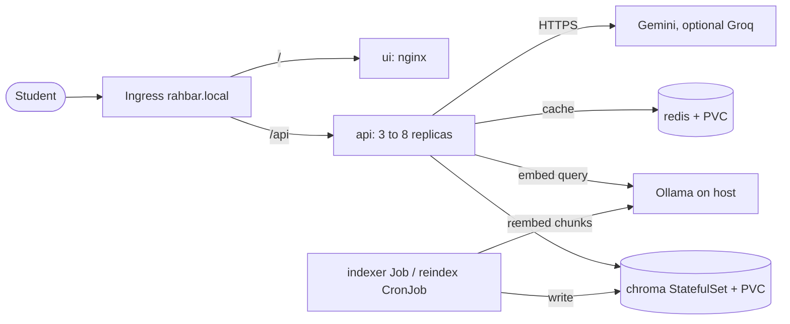

# RAHBAR

[](https://github.com/Honey822438/Rahabar-Ai-Agent/actions/workflows/ci.yml)
[](https://github.com/Honey822438/Rahabar-Ai-Agent/actions/workflows/cd.yml)

**Team:** Rehan Ahmed (i24-3012) and Malaika (i24-3098).

FAST-NUCES students have to dig through long handbooks, scanned PDFs and web pages to find a rule or fee, and a general chatbot can invent an answer that sounds right. RAHBAR answers only from an indexed set of real university documents, cites the source, section and page, and says so when the documents don't cover a question. It runs on Kubernetes (minikube) with a separate indexing Job, a vector database, a semantic cache and CI/CD.

## Architecture



Details are in [docs/ARCHITECTURE.md](docs/ARCHITECTURE.md). Decisions are in [docs/adr/](docs/adr/).

## From a clean clone to an answered question

**You need:** Docker, kubectl, minikube, Python 3.12, Ollama, and a Gemini API key from AI Studio. Allow about 6 GB of RAM for minikube.

Run these in order from the repository root.

**1. Start Ollama on the host**, in its own terminal, so the cluster can reach it:

```bash
ollama pull nomic-embed-text
OLLAMA_HOST=0.0.0.0 ollama serve
```

**2. Start the cluster** (minikube with Calico, metrics-server and ingress):

```bash
make cluster
```

The NetworkPolicy expects Ollama at `192.168.49.1`, minikube's default gateway. Check with `minikube ssh -- grep host.minikube.internal /etc/hosts`. If it differs, change the `ipBlock` entries in `k8s/base/networkpolicy.yaml`.

**3. Build the images inside minikube:**

```bash
make images
```

**4. Create the namespace, then the Secret.** The key is read without appearing on screen or in shell history, and is never committed:

```bash
kubectl apply -f k8s/base/namespace.yaml
read -rs LLM_API_KEY
kubectl create secret generic rahbar-secret -n rahbar --from-literal=LLM_API_KEY="$LLM_API_KEY"
unset LLM_API_KEY
```

To add the optional Groq fallback, also pass `--from-literal=GROQ_API_KEY=...` to the same command, reading it the same way.

**5. Apply everything else.** This also starts the indexer Job:

```bash
kubectl apply -k k8s/overlays/dev
```

**6. Wait for the first index**, about 9 minutes on a CPU. API pods stay `0/1` until it finishes, because `/readyz` needs a non-empty collection:

```bash
kubectl wait --for=condition=complete job/indexer -n rahbar --timeout=900s
kubectl rollout status deploy/api -n rahbar --timeout=180s
```

**7. Ask a question through the Ingress:**

```bash
make ask Q="What minimum CGPA is required to avoid academic warning?"
```

For the web UI, add the host once and open <http://rahbar.local/>:

```bash
echo "$(minikube ip) rahbar.local" | sudo tee -a /etc/hosts
```

## Re-indexing

The API never indexes. A re-index needs no redeploy, and the cache clears itself when the API sees the new index:

```bash
kubectl create job --from=cronjob/reindex manual-reindex-1 -n rahbar
```

The `reindex` CronJob also runs this weekly.

## API

| Method | Path | Through the Ingress | Purpose |
| --- | --- | --- | --- |
| POST | `/api/ask` | Yes | Body `{"question": "..."}` (3 to 500 characters). Returns the answer, citations, `answered_from_context`, confidence, retrieved chunks, provider and `cached` |
| GET | `/healthz` | No | Liveness; touches no dependency |
| GET | `/readyz` | No | Readiness; 503 names the failed check |
| GET | `/metrics` | No | Prometheus metrics |

To reach the last three: `kubectl port-forward -n rahbar svc/api 8000:8000`. If the Service port differs, see `k8s/base/services.yaml`.

## Local development and tests

No cluster or network needed; these use stub providers:

```bash
make install && make test && make lint
make dev    # API and UI on http://localhost:8000
```

## CI/CD

- **`ci.yml`:** lint, tests, manifest validation, image builds, a Trivy scan and an end-to-end eval on a kind cluster.
- **`cd.yml`:** on `main`, test, then push images tagged with the commit SHA to Docker Hub, then deploy that SHA to a temporary kind cluster and smoke-test through the Ingress. The smoke test uses fixtures and a stub LLM.

## Documents

[Corpus](docs/CORPUS.md) · [Pipeline](docs/PIPELINE.md) · [Engineering notes](docs/ENGINEERING-NOTES.md) · [Failure analysis](docs/FAILURE-ANALYSIS.md) · [AI usage](docs/AI-USAGE.md) · [Evidence](docs/evidence/)

## License

See [LICENSE](LICENSE).
