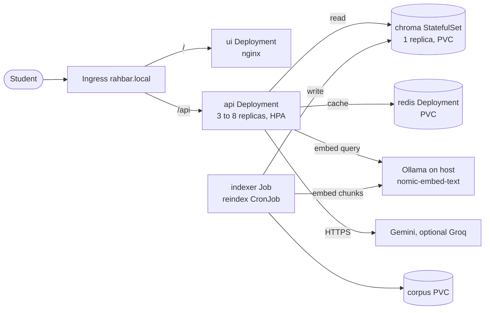

# Architecture

RAHBAR answers questions only from an indexed set of FAST-NUCES documents. Everything runs in namespace `rahbar` on minikube, except Ollama (on the host) and the hosted LLM.

## Request path
1. The Ingress sends `/api/*` to the API unchanged.
2. The API embeds the question and checks the semantic cache, unless the question is a follow-up or asks about an older version.
3. On a miss it retrieves `TOP_K` chunks, filtering out superseded documents unless the question asks for an older version.
4. If the best score is under `RELEVANCE_FLOOR`, it abstains without calling the LLM.
5. Otherwise it generates strict JSON and validates it, retries once, then uses a canned fallback.
6. Citations that don't match a chunk retrieved for this request are dropped.

## Index path
Only the Job and CronJob write to Chroma. They fetch and verify the corpus into a PVC, then extract, clean, chunk and embed it, build a new collection, and swap it in. The API only reads (see ADR 0001).

## Why Chroma is a StatefulSet
Chroma keeps its data on disk, so a pod's identity and volume must stay together. A StatefulSet gives `chroma-0` a stable name and its own PVC from `volumeClaimTemplates` (`k8s/base/chroma-statefulset.yaml`). If the pod is replaced, the new `chroma-0` reattaches the same volume.

A Deployment suits interchangeable pods. Scaled up, its replicas would share one claim or lack one, and a rolling update could start a new pod while the old one still has the data open. We run one replica because Chroma in this mode is not a replicated cluster, so more pods would mean separate, inconsistent data. That makes it a single point of failure for answers. When it is down, `/readyz` takes the API out of the Service.

Redis is a Deployment with a PVC because it is a cache we can lose: losing it costs some extra generation calls, not correctness.

## Kubernetes objects
| Object | Purpose |
| --- | --- |
| Namespace `rahbar` | Holds everything |
| Deployment + HPA `api` | 3 to 8 replicas on CPU; `maxSurge: 1`, `maxUnavailable: 0`; three separate probes |
| Deployment `ui` | Static page on unprivileged nginx |
| StatefulSet `chroma` | Vector store with its own PVC |
| Deployment + PVC `redis` | Semantic cache and stored turns |
| Job `indexer`, CronJob `reindex` | The only Chroma writers; weekly, or on demand |
| PVC `corpus` | Downloaded source documents |
| 4 ClusterIP Services | api, ui, chroma, redis; nothing is NodePort or LoadBalancer |
| Ingress | `/` to ui, `/api` to api |
| ConfigMap `rahbar-config` | All tunables, including the embedding pin |
| Secret `rahbar-secret` | Created by command; only a placeholder is in Git |
| NetworkPolicies | Default deny, then only the paths in the diagram plus DNS |
| ServiceAccounts | One per workload, with no token mounted |

## Network and container security
Ingress may reach ui and api; api and indexer may reach chroma; only api may reach redis. API egress is limited to Chroma, Redis, DNS, Ollama's IP on port 11434 and HTTPS to non-private addresses (`k8s/base/networkpolicy.yaml:84-111`). The test is in `docs/evidence/networkpolicy-test.txt`.

Containers run as non-root with a read-only root filesystem and all capabilities dropped. Requests and limits come from measured peaks (`docs/evidence/kubectl-top.txt`).

## Probes
| Probe | Path | On failure |
| --- | --- | --- |
| startup | `/healthz` | Other probes wait, up to 60 seconds |
| liveness | `/healthz` (touches nothing) | Container restarts |
| readiness | `/readyz` (Chroma, collection, Redis, embed pin) | Pod leaves the Service, with no restart |

## Observability
JSON logs on stdout carry a `request_id`, and each answer logs its chunk ids, scores, abstained, cached and provider. `/metrics` exposes request, retrieval and generation latency, cache lookups, abstentions, fallbacks and tokens.

## Known limits
- Chroma is a single replica.
- The Ollama NetworkPolicy IP (`192.168.49.1`) is minikube's default docker gateway; another network needs it changed.
- The API's CPU-based HPA is a weak signal for this workload (`docs/ENGINEERING-NOTES.md`, question 3).
